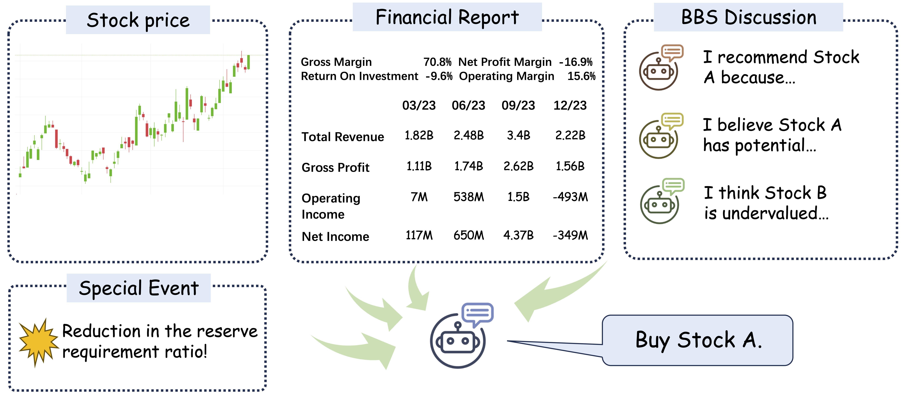
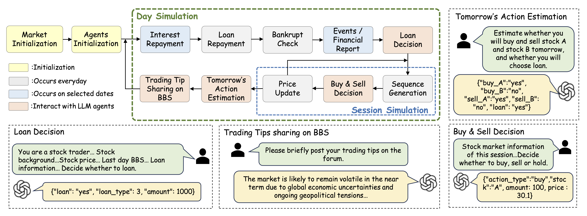

# When AI Meets Finance (StockAgent): Large Language Model-based Stock Trading in Simulated Real-world Environments




Can AI Agents simulate real-world trading environments to investigate the impact of external factors on stock trading activities (e.g., macroeconomics, policy changes, company fundamentals, and global events)? These factors, which frequently influence trading behaviors, are critical elements in the quest for maximizing investors' profits. Our work attempts to solve this problem through large language model-based agents. We have developed a multi-agent AI system called StockAgent, driven by LLMs,  designed to simulate investors' trading behaviors in response to the real stock market. The StockAgent allows users to evaluate the impact of different external factors on investor trading and to analyze trading behavior and profitability effects. Additionally, StockAgent avoids the test set leakage issue present in existing trading simulation systems based on AI Agents. Specifically, it prevents the model from leveraging prior knowledge it may have acquired related to the test data. We evaluate different LLMs under the framework of StockAgent in a stock trading environment that closely resembles real-world conditions. The experimental results demonstrate the impact of key external factors on stock market trading, including trading behavior and stock price fluctuation rules. This research explores the study of agents' free trading gaps in the context of no prior knowledge related to market data. The patterns identified through StockAgent simulations provide valuable insights for LLM-based investment advice and stock recommendation. 

## Link
ARXIV LINK: https://arxiv.org/pdf/2407.18957

Accepted by Transactions on Intelligent Systems and Technology (ACM TIST)
## Architecture


The Workflow of Trading Simulation Flow. There are four Phases, namely **Initial Phase**, **Trading Phase**, **Post-Trading Phase** and **Special Events Phase**. In the Post-Trading Phase, Daily events and Quarterly events occur with daily and quarterly frequency respectively. A Specific Events Phase is an event that occurs randomly and acts on a random trading day.

## Quick Start

#### Environment

```
conda create --name stockagent python=3.9
conda activate stockagent

git clone https://github.com/dhh1995/PromptCoder
cd PromptCoder
pip install -e .
cd ..

git clone <This Github Project>
cd Stockagent
pip install -r requirements.txt
```

#### API keys

Use GPTs as agent LLM:

```
export OPENAI_API_KEY=YOUR_OPENAI_API_KEY
```

Use Gemini as agent LLM:

```
export GOOGLE_API_KEY=YOUR_GEMINI_API_KEY
```

#### Start simulation

You can choose a basic LLM and start simulation in one line:

```
python main.py --model MODEL_NAME
```

We set gemini-pro for default LLM.

## Read-only IBKR suggestion dashboard

`ibkr_dashboard.py` is a local dashboard for the `AAPL`, `MSFT`, `NVDA`, and
`SPY` watchlist. It requests snapshot market data from an already authenticated
Interactive Brokers TWS or IB Gateway session. It **does not contain any order
placement, modification, or cancellation code**.

1. Install the additional dependencies:

   ```
   pip install -r requirements.txt
   ```

2. Start TWS or IB Gateway, sign in to your IBKR account, and enable API
   connections. The live TWS API port is normally `7496`; paper TWS normally
   uses `7497`.

3. Start the dashboard:

   ```
   python ibkr_dashboard.py
   ```

4. Open `http://127.0.0.1:5000` in a browser. The dashboard is deliberately
   bound to your own computer and does not expose an order-entry endpoint.

Optional environment variables:

```
IBKR_HOST=127.0.0.1
IBKR_PORT=7496
IBKR_CLIENT_ID=21
IBKR_WATCHLIST=AAPL,MSFT,NVDA,SPY
```

The suggestions are simple previous-close price-change indicators: at least 2%
below close produces `WATCH FOR BUY`, at least 2% above produces `WATCH FOR
SELL`, and otherwise the dashboard shows `HOLD / MONITOR`. They are educational
signals, not personalized financial advice.

#### About ’procoder‘

Here we use the: https://github.com/dhh1995/PromptCoder.git this tool, please download after its installation.

#### Citation
If you find the code is valuable, please use this citation.
```
@article{zhang2024ai,
  title={When ai meets finance (stockagent): Large language model-based stock trading in simulated real-world environments},
  author={Zhang, Chong and Liu, Xinyi and Zhang, Zhongmou and Jin, Mingyu and Li, Lingyao and Wang, Zhenting and Hua, Wenyue and Shu, Dong and Zhu, Suiyuan and Jin, Xiaobo and others},
  journal={arXiv preprint arXiv:2407.18957},
  year={2024}
}
```

